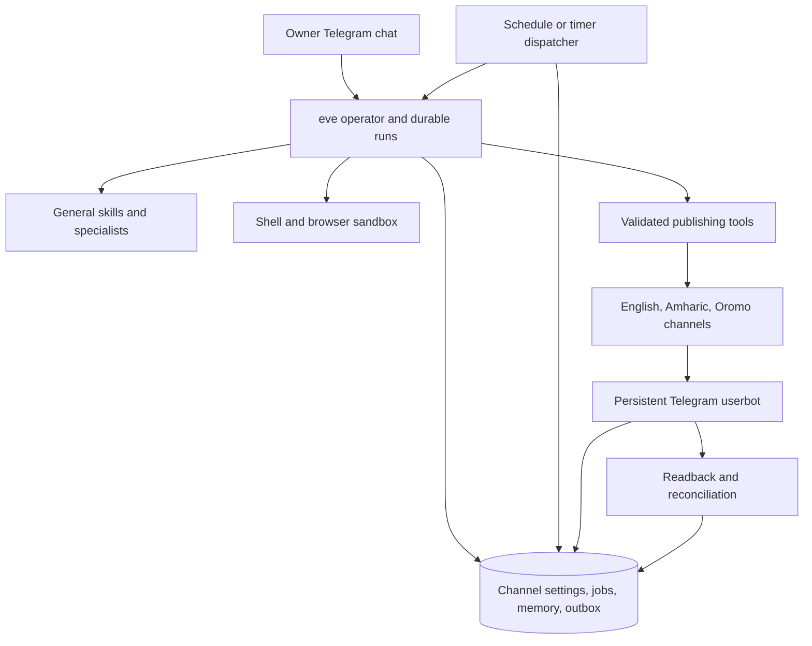

# eve research for the Telegram agent

Research date: 2 October 2026. Implementation baseline: the installed `eve@0.70.0` package, its bundled documentation, and the project's eve skill. Official online documentation and examples were checked for corroboration. Online `main` is not a version pin; implementation must follow the installed package's APIs.

## Recommendation

Build a general-purpose conversational operator with eve. Give it shell, search, fetch, browser automation, memory, and integrations. Add an application-owned job store and publishing tools so requests can become reliable ongoing work.

The user experience should be: describe an outcome in Telegram, let the agent resolve the destination and save a job, then inspect, change, pause, or cancel that job through conversation. News publishing is one skill and workflow within this broader agent.

Eve already supplies the agent loop, durable sessions, tool execution, tasks, memory lifecycle, channel routing, and schedules. We should use these rather than implement a separate agent framework. We still own business rules, Telegram user-account access, publication records, and reconciliation of uncertain external actions.

## What each feature contributes

| Feature in the screenshot | What eve supplies | How this project should use it |
|---|---|---|
| Agent configuration | Model, reasoning, compaction, usage limits, workflow backend | Configure the root operator and bounded specialist sessions; preserve the current model until evaluated or explicitly changed. |
| Instructions | Markdown or TypeScript; composed and dynamic context | Define a general operator that takes action, verifies outcomes, and distinguishes source content from authorized requests. |
| Skills | Procedures loaded on demand, with supporting files | News research, channel setup, image selection, English/Amharic/Afaan Oromo writing, corrections, and unfamiliar tasks. |
| Sandbox | Session-owned filesystem and shell, provider selection, reusable prepared environments | Real command execution and browser support using an explicitly selected container or VM provider. |
| Schedules | Root-level cron prompts or handlers | Wake a dispatcher that claims due jobs from storage; users change stored job rows rather than source files. |
| Hooks | Runtime event subscribers | Audit actions, measure failures and latency, record costs, and alert the owner. |
| Memory | Scoped cross-session recall, capture, and provider tools | Recall owner preferences, channel style, terminology, and editorial lessons. |
| Tools | Validated actions and durable workflow tools | Manage channels/jobs, publish text/media, edit/delete, verify, and reconcile ambiguous sends. |
| Connections | MCP/OpenAPI clients, authentication, filtering, approvals, discovery | Add services and expose a narrow userbot API; keep integration credentials in trusted code. |
| Channels | Messaging entry points and conversation routing | Use native Telegram for owner chat and eve HTTP for development or a future dashboard. |
| Subagents | Root copies or declared specialists, independent durable sessions | Separate research and language review when this improves quality; grant only required capabilities. |
| Dynamic capabilities | Resolve instructions, models, tools, connections, skills, and specialists at runtime | Load the active channel configuration and expose actions according to the authenticated owner and job scope. |

The relevant installed pages are `agent-config.md`, `instructions.mdx`, `skills.mdx`, `sandbox/index.mdx`, `schedules.mdx`, `guides/hooks.md`, `memory/overview.mdx`, `tools/overview.mdx`, `tools/workflows.mdx`, `connections/overview.mdx`, `channels/telegram.mdx`, `subagents/index.mdx`, and `guides/dynamic-capabilities.md`, all under `node_modules/eve/docs/`.

## General capabilities available now

Eve's optional default tool set includes `bash`, `read_file`, `write_file`, `web_fetch`, provider-dependent `web_search`, and root-copy delegation through `agent`. Skills gain `load_skill`. Connections gain `connection_search` and `connection_execute` without exposing every remote tool schema permanently.

Additional framework tools include `glob`, `grep`, `ask_question`, `sleep`, and `no_reply`. `no_reply` is useful when monitoring finds nothing worth reporting. Search availability depends on the selected provider; it must be tested with the actual deployed model and credentials.

This means we do not need to author basic shell or search tools from scratch. However, fetching a URL is different from driving an interactive browser. The official [integration catalog](https://eve.dev/integrations) lists agent-browser, Browserbase/Stagehand, KERNEL, and Browser Use options. Choose one after checking its registry entry, infrastructure, credentials, and installed-version compatibility. These were discovered, not installed or tested in this research.

Source: installed `concepts/built-in-tools.md`, plus the official integration catalog.

## Terminal access and the sandbox boundary

Eve separates the trusted application runtime from the agent's sandbox. Authored tools, connections, model calls, and hooks run in Node.js. Model-directed shell and file operations are proxied into a session-owned sandbox rooted at `/workspace`.

For this project, explicitly select Docker on a self-hosted server, or Vercel Sandbox for hosted isolated compute. Prepare an environment containing the necessary command-line tools, Python/image utilities, and browser dependencies. Do not depend on automatic provider selection for a production requirement.

The default selects Vercel Sandbox on Vercel; elsewhere it tries Docker, microsandbox, then just-bash. The last option is a JavaScript shell with a virtual filesystem: it does not run native processes or provide network isolation. Consequently, the existence of a `bash` tool alone does not establish that native browser automation or arbitrary programs will work.

Sandboxes are session-owned. Files surviving multiple turns are not automatically global storage shared by every scheduled run. Keep authoritative channel configuration and job records in application storage. A sandbox can hold working scripts, temporary media, and analysis output.

Bot tokens and the userbot login session belong in trusted services. Giving the sandbox raw publishing credentials would let shell commands bypass the controlled publishing tools and their ledger.

Sources: installed `sandbox/index.mdx`, `sandbox/default.mdx`, `sandbox/docker.mdx`, `sandbox/just-bash.mdx`, and `concepts/security-model.md`; [official sandbox source](https://github.com/vercel/eve/blob/main/docs/sandbox/index.mdx).

## Natural language becomes persistent configuration

For a request such as “latest AI news for @channel in English, occasionally with photos,” the operator should:

1. Resolve `@channel` to a stable Telegram chat ID and confirm that the owner controls the configured destination.
2. Check bot membership and the relevant permissions.
3. Convert the request into validated settings, with defined defaults for unspecified details.
4. Save the configuration and job in one durable transaction.
5. Return the actual saved settings and job identifier.
6. Run an initial check, if requested or appropriate, and report the verified result.

Suggested settings include language, topics, source lists, check interval, posting limits, timezone/quiet hours, image policy, style guidance, freshness window, review mode, and enabled status. Give vague preferences explicit semantics: `imagePolicy: occasional` might mean include a relevant image when it adds value, bounded by a configured frequency. Keep collection cadence separate from publication cadence.

Use stable IDs, versions, and ownership checks. A schedule change should affect future runs; a pause should prevent queued jobs from publishing by rechecking status immediately before send. Channel ownership should be revalidated as permissions change.

Eve's [dynamic scheduling pattern](https://github.com/vercel/eve/blob/main/docs/patterns/dynamic-scheduling.md) documents a single dispatcher with atomically leased application-owned schedule rows. This is a close match for conversationally managed channels.

## Three different forms of memory

| Storage | What belongs there | Lifetime |
|---|---|---|
| `defineState` | Current plan, intermediate findings, counters | One durable session |
| Eve memory slot | Stable preferences, language terminology, channel editorial context | Across sessions, according to the provider |
| Application database | Schedules, channel settings, source cursors, publication IDs, job state | Authoritative operational records |

Do not rely on a remembered paragraph to decide whether a job is enabled or a post has already been sent. Those are database facts. The same database can also back an eve memory provider, so this distinction does not require multiple storage products.

Eve supports the built-in file provider, hosted semantic providers, and custom providers with recall/capture/tools. File memory is model-maintained rather than automatically extracted. In `eve dev`, its default backend is process-local memory and disappears when the process is replaced. On self-hosted production it needs an explicit backend. Vercel deployments can use private Blob.

Another important detail: `byPrincipal` disables memory for anonymous and runtime principals. Scheduled jobs using `appAuth` therefore need an intentionally scoped channel-memory resolver, or a correctly authenticated owner dispatch. Derive the scope from trusted job/auth context, not a model-supplied channel name.

Sources: installed `concepts/state.md`, `memory/overview.mdx`, `memory/file.md`, `memory/custom-provider.md`; [official memory documentation source](https://github.com/vercel/eve/blob/main/docs/memory/overview.mdx).

## Scheduling, durable waits, and continuous monitoring

Eve cron uses five fields and minute granularity. `eve dev` does not fire cron automatically; its dev-only dispatch route triggers a schedule for testing. The standard `eve build` and `eve start` path runs production schedules. On Vercel, schedules become Vercel Cron jobs evaluated in UTC.

Cron is only one timing mechanism. The opt-in `sleep` tool can durably suspend and resume a turn, and workflow tools can await Workflow timers or webhooks. This corrects the earlier impression that all finer-grained waiting must be implemented outside eve.

Nevertheless, documented durable waits are not a guarantee of precise one-second execution. Continuous MTProto ingestion and consistently low-latency checks are a better fit for a persistent worker. Measure actual timer latency and workflow overhead before choosing a one-second durable loop. Running an LLM or web search every second should not be the default implementation of watching for updates.

Recommended arrangement: receive source Telegram updates continuously, fetch web/RSS sources according to freshness needs, and wake bounded eve jobs when there is new material or a channel becomes due. Use one-minute cron as dispatch/recovery for ordinary intervals; add a persistent timer dispatcher for explicit sub-minute requirements.

Sources: installed `schedules.mdx`, `concepts/built-in-tools.md`, `tools/workflows.mdx`; [official schedules source](https://github.com/vercel/eve/blob/main/docs/schedules.mdx).

## Telegram conversation versus Telegram publishing

Use eve's native Telegram channel for private owner conversations, questions, progress, and approvals. The installed implementation verifies the webhook secret header, handles private/group routing, supports inbound photos/documents subject to upload policy, and renders questions through Telegram controls.

The installed channel's default completed reply uses plain `sendMessage`; it is not a complete media publishing pipeline. Author separate text/photo/album publication tools and explicit edit/delete tools. Also, a channel handoff through `to(...).send(...)` starts or resumes an agent conversation: it is not equivalent to directly sending an already prepared post.

The userbot is a separate user-account Telegram client. Its jobs are source ingestion, history reads, media retrieval where available, and independent destination verification. General channel-history retrieval is user-only according to [Telegram's API](https://core.telegram.org/method/messages.getHistory). Its login/session lifecycle, reconnects, cursors, and flood waits must be implemented in that service. Source channels with protected content require compatible handling rather than assuming their media can always be reused.

The bot needs destination admin permissions. API acceptance and a returned message ID are one verification level; reading the actual message back is a stronger check. Verify text/caption, destination, media count, and album grouping. Store all message IDs for albums. Bot deletion has restrictions, including the usual 48-hour window; support corrective follow-up posts when a requested operation is unavailable. [Telegram Bot API](https://core.telegram.org/bots/api#deletemessage)

Source: installed `channels/telegram.mdx`, plus Telegram's official APIs.

## Workflow tools and specialists

Ordinary `defineTool` executors are good for validated operations. `defineWorkflowTool` is appropriate when code must durably wait, retry steps, or coordinate specialists. It has three entry forms: blocking `execute`, asynchronous `task`, and resumable `serve`.

A background task returns a receipt, but it is not automatically an independent permanent scheduler. The parent turn cannot simply end while active tasks are working, and cancellation/lifetime are linked to the owning session. Store long-lived jobs independently and use bounded runs rather than making every channel a never-ending task in the owner's private chat.

For a news run, a workflow can collect evidence, call a researcher, request language review, validate the result, enqueue publication, then verify delivery. Run independent language drafts in parallel when useful. Pass explicit evidence and settings to each child: declared specialists do not inherit the root's authored capabilities or conversation history.

Use `defaultTools: false` and explicit web/read tools for research/review specialists that should not publish. Leaving an omitted tool directory is insufficient to disable framework defaults. Keep the root's general capabilities available for owner requests.

Potential specialists: researcher, language reviewer, and image evaluator. Separate English/Amharic/Oromo agents are optional; use them only if they improve quality compared with language-specific skills and explicit prompts.

Sources: installed `tools/workflows.mdx`, `tools/tasks.md`, and `subagents/index.mdx`.

## Dynamic capabilities and hooks

Dynamic instructions should load the current channel configuration at a suitable lifecycle boundary. Dynamic tools/connections can adapt available services to authenticated ownership. Dynamic model selection can route image analysis or difficult editorial work to an appropriate model, but switching models can reduce prompt-cache reuse.

Resolved capabilities do not replace authorization inside tools. Before an action, the executor must check ownership, job status, configuration version, and destination permissions again. Resolvers may be rerun during recovery and should be idempotent. Dynamic tool callbacks have serialization requirements; live clients and credentials should be reconstructed in trusted runtime code.

Hooks observe events after they are durably recorded. They are useful for audit trails, metrics, and alerts, but throwing from a hook does not veto the turn and a hook error does not automatically retry. They are not an enforcement substitute for publishing tools. Events can be emitted again with new event IDs after interrupted-step replay; use stable business operation keys for once-per-operation side effects.

Sources: installed `guides/dynamic-capabilities.md`, `guides/hooks.md`; [official dynamic capabilities source](https://github.com/vercel/eve/blob/main/docs/guides/dynamic-capabilities.md).

## Recovery is not exactly-once publishing

Eve checkpoints completed steps and replays their recorded results. Interrupted steps can execute again, including tool side effects. An external service may also accept a request whose response never reaches the app.

Use an application-owned outbox and publication ledger with a unique operation key, such as channel + story + publication version. Atomically claim work, record delivery intent before send, save Telegram IDs, and verify readback. On an ambiguous result, reconcile the destination before retrying. If reconciliation remains inconclusive, mark the publication uncertain and notify the owner; do not claim success or blindly resend.

Distinguish failures by stage. If publication succeeded but verification failed, retry verification, not publication. Handle each channel independently so one failed translation or upload does not republish successful destinations. Telegram does not offer an atomic transaction across three channels, so represent partial completion explicitly.

The official [outbox pattern](https://github.com/vercel/eve/blob/main/docs/patterns/durable-cross-channel-notifications.md) makes this limitation explicit. This is the largest piece of reliability logic we must author ourselves.

## Proposed deployment

My recommendation is an always-on server for the first version: eve Node service, explicit Docker sandbox, durable database, and userbot worker. This keeps continuous Telegram access and optional sub-minute timing straightforward. A Vercel eve runtime plus external userbot worker is also viable, particularly if managed workflows and sandboxes are preferred.

For self-hosting, persist `.eve/.workflow-data` when using the local Workflow world, or deliberately select a compatible external world. A database used for channel settings does not automatically back eve workflow state. Preserve both `/eve/` and `/.well-known/workflow/` through the proxy. Back up workflow state, application records, media metadata, and userbot session material appropriately.

Source: installed `guides/deployment/self-hosting.md`; [official self-hosting source](https://github.com/vercel/eve/blob/main/docs/guides/deployment/self-hosting.md).

## What robust should mean in verification

Use eve evals for conversation-to-action behavior and integration tests for external delivery/recovery:

- A natural-language request saves the intended channel, language, interval, and image policy.
- Later conversational changes update the existing job rather than creating duplicates.
- A restart preserves settings, source cursors, and pending publication work.
- Overlapping dispatches claim a job only once concurrently.
- A send accepted just before a simulated timeout is reconciled without reposting.
- A failed verification retries readback; a failed channel does not republish successful channels.
- Pausing a job blocks queued publication before send.
- Untrusted source text cannot change schedules or authorize shell/publishing actions.
- Wrong-owner requests cannot operate another channel.
- Numbers, names, dates, attribution, and uncertainty survive all three language versions.
- No-news runs remain quiet; source outages and permission failures are visible to the owner.
- Text, photo, album, edit, and delete outcomes are checked in real test channels.

Eve evals drive actual sessions and allow deterministic fixtures and model grading. Native-speaker review should supplement model grading for Amharic and Afaan Oromo. Measure total provider calls, browser/search charges, sandbox use, and worker cost; eve's model-token cost cap is not a global infrastructure budget.

Source: installed `evals/overview.mdx` and `agent-config.md`.

## Implementation sequence

1. Establish Node 24 and model credentials; add native Telegram owner chat, explicit sandbox, and one browser integration. Test a real conversational task.
2. Add database-backed channel/job tools and correctly scoped cross-session memory. Test changes and restart persistence.
3. Add the userbot service, source ingestion, publishing tools, outbox, and readback verification. Prove one English channel end to end.
4. Add dispatch scheduling, deduplication, source grounding, and image policy. Exercise overlapping runs and ambiguous delivery recovery.
5. Add Amharic/Afaan Oromo skills and targeted reviewers; verify language quality and independent per-channel results.
6. Add operational tracing, outcome evals, failure alerts, and optional sub-minute monitoring after measuring overhead.

The official [social media template](https://eve.dev/templates/typefully-eve-template) is a useful reference for research/review specialists, platform style skills, preferences, media assets, and scheduled publishing-related work. Its Slack/Typefully setup and approval choices should not be copied as requirements for this Telegram application.

## Research limits and current project status

The project remains a starter with its original model and HTTP channel. This research changed no executable configuration and provisioned no services. The installed CLI registry search failed before running because the shell uses Node 22.22.0; eve requires Node 24+. Integration availability was checked through official documentation/catalog pages instead, so exact installation prerequisites remain to be verified with the registry under Node 24.

Several eve.dev pages return Markdown that the web reader could not ingest. The installed version-matched docs were used directly, and public repository sources were read as corroboration. No live bot, userbot, browser integration, workflow backend, or restart recovery was tested. Production self-modification is not provided by the bundled local-development extension: changing saved settings is different from changing deployed source code.
